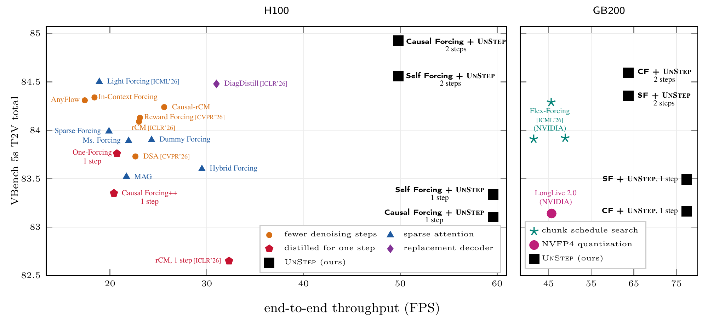
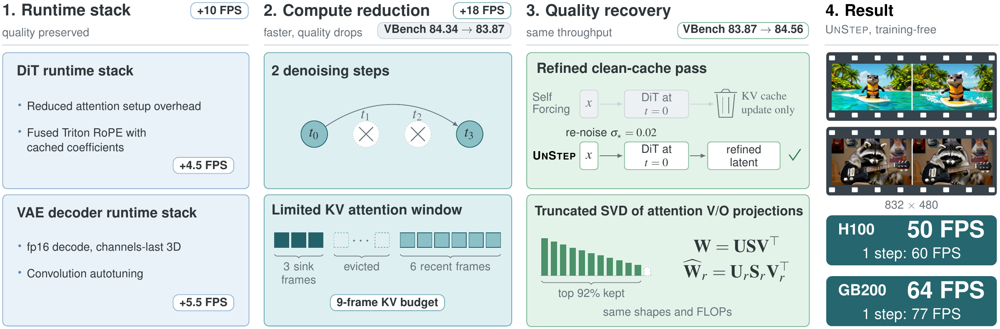
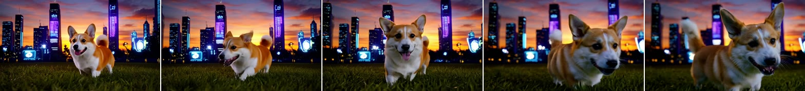

<h1 align="center">UnStep</h1>

<p align="center"><b>Training-Free Acceleration of Causal Video Diffusion with Fewer Steps Than Distillation</b></p>

<p align="center">
  <a href="https://arxiv.org/abs/2609.32518">Paper</a> &nbsp; | &nbsp;
  <a href="https://y-mansour.github.io/UnStep/">Project website</a>
</p>

<p align="center">
  <b>50 FPS on a single H100 &nbsp; · &nbsp; 64 FPS on GB200</b><br>
  Default two-step wrapper &nbsp; · &nbsp; 832 × 480 &nbsp; · &nbsp; No retraining<br>
  <sub>One step: 60 FPS on H100 and 77 FPS on GB200.</sub>
</p>

UnStep accelerates existing few-step causal video models based on Wan 2.1, entirely at inference. It combines fewer denoising steps and a smaller KV attention window with clean-cache refinement, truncated SVD, and an optimized DiT/VAE runtime stack.

## Results

**A new throughput regime on both H100 and GB200, entirely training-free.**



## Method



## Start here

Install the environment and assets, then generate and evaluate. Run shell examples from the repository root.

| Task | Where to go |
| --- | --- |
| Install the environment, attention backend, and assets | [Installation](installation/) |
| Generate five-second T2V clips and measure speed | [Generation](generation/) |
| Evaluate with VBench | [Evaluation](evaluation/) |
| Image-to-video and long video | [I2V](generation/i2v.md) and [long video](generation/long_video.md) |

Generation includes [checkpoint and method options](generation/#method-settings)
and a [speed-only command](generation/speed.md). The
[file guide](generation/#code-layout) identifies the implementation and launchers.

## Samples

Selected frames from five-second videos generated by **Self Forcing + UnStep**, using the default two-step wrapper.
Figure sources and sample prompts are documented in [media/](media/).

**A corgi in a cyberpunk park**



**A rabbit exploring a fantasy landscape**


**A raccoon playing guitar in a boat**


## Image-to-video

UnStep supports image-conditioned generation without task-specific retuning. The paper evaluates 1,118 image-prompt pairs from 355 reference images using VBench-I2V's official 16:9 crops, at 832 x 480 and 16 FPS.

See the [I2V guide](generation/i2v.md) for image downloads, generation, and evaluation.

## Long video

The paper evaluates 30.56-second clips on VBench++'s 40-prompt long-video competition track. UnStep keeps the same method settings and uses blockwise VAE decoding for longer clips.

See the [long-video guide](generation/long_video.md) for duration controls, generation, and evaluation.

## Citation

```bibtex
@misc{mansour2026unsteptrainingfreeaccelerationcausal,
  title = {UnStep: Training-Free Acceleration of Causal Video Diffusion with Fewer Steps Than Distillation},
  author = {Youssef Mansour and Enis Simsar and Fadime Sener and Markos Georgopoulos and Albert Pumarola and Ali Thabet and Edgar Schoenfeld},
  year = {2026},
  eprint = {2609.32518},
  archivePrefix = {arXiv},
  url = {https://arxiv.org/abs/2609.32518}
}
```

## Acknowledgments

UnStep builds on [Self Forcing](https://github.com/guandeh17/Self-Forcing), including its Wan2.1 implementation, and uses [VBench](https://github.com/Vchitect/VBench) for evaluation. We thank their authors for releasing their code. Code attribution and licenses are listed in [THIRD_PARTY_NOTICES.md](THIRD_PARTY_NOTICES.md).

## Contributing

See [CONTRIBUTING.md](CONTRIBUTING.md) and our [Code of Conduct](CODE_OF_CONDUCT.md).

## License

[CC BY-NC 4.0](LICENSE). Third-party code and model weights retain their own licenses.
